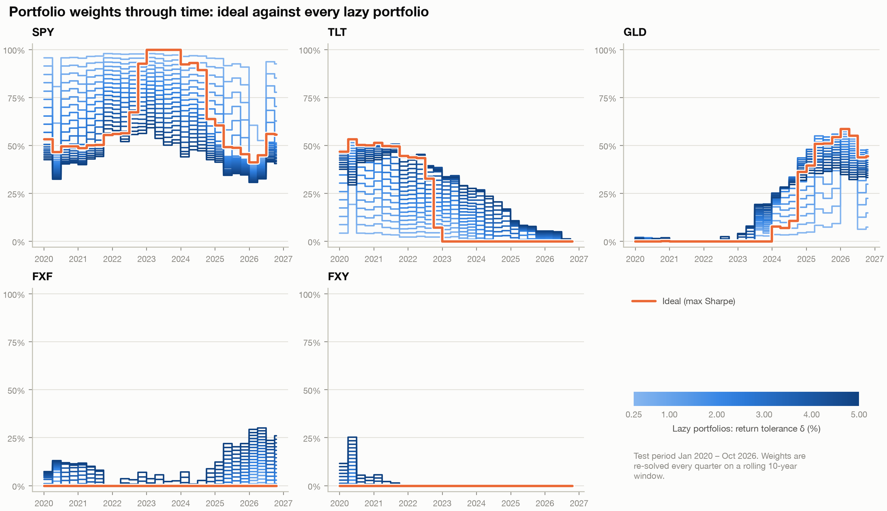
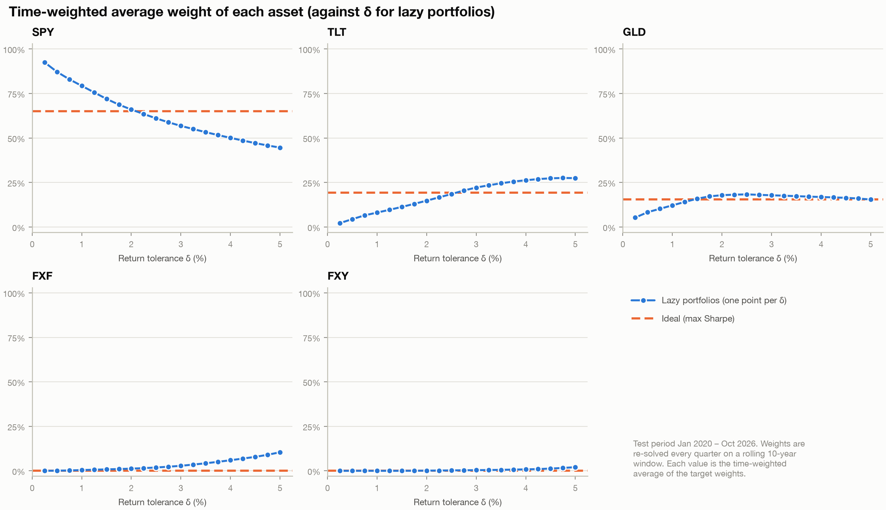
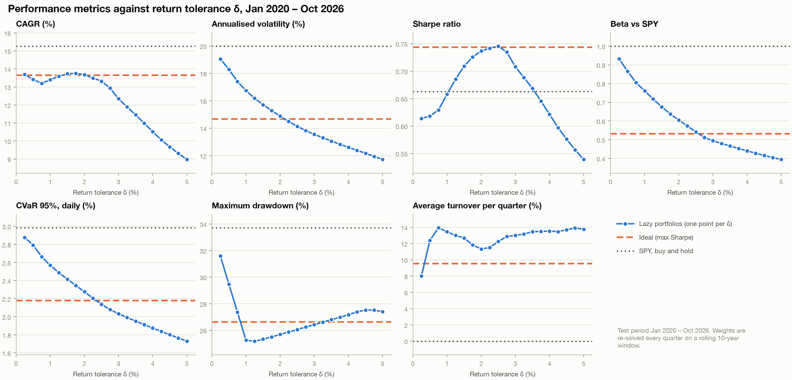

# Defensive Portfolio Optimisation

A Python project investigating whether diversified, long-only portfolios can reduce risk relative to an S&P 500 benchmark while preserving expected returns.

## About

This project uses Modern Portfolio Theory to construct defensive portfolios from five ETFs: SPY (S&P 500 equities), TLT (long-term US Treasuries), GLD (gold), FXF (Swiss franc exposure), and FXY (Japanese yen exposure). It compares minimum-variance portfolios subject to return constraints (the **'lazy' portfolios**) with a maximum-Sharpe-ratio **'ideal' portfolio**.

For each 'lazy' portfolio, estimated annualised expected return must be at least the estimated return of SPY minus a tolerance $\delta$. The tolerance ranges from **0.25 to 5 percentage points**, in increments of 0.25 percentage points, with a separate **minimum-variance** portfolio constructed at each level.

The 'ideal' portfolio instead maximises the **estimated Sharpe ratio** within the same long-only, fully invested asset universe. 

For the Sharpe ratio calculations, the risk-free rate is approximated as the 3-month US Treasury yield.

Portfolio weights are estimated using rolling 10-year historical windows. Out-of-sample performance is evaluated beginning in January 2020, with quarterly rebalancing.

A simple 100% SPY portfolio is also used for comparison.

Performance is evaluated using the Sharpe ratio, beta, 95% daily-return conditional value at risk (CVaR), and maximum drawdown, alongside realised return and volatility.

Transaction costs are ignored for simplicity. All portfolios are long-only, and fully invested without leverage. 

## Methodology

The initial portfolio weights for January 2020 are estimated using approximately 10 years of historical observations beginning in January 2010. Weights are subsequently recalculated every quarter using a rolling 10-year estimation window. The optimisation uses historical estimates of expected returns and covariances; realised performance is assessed over the subsequent backtest period.

The intended backtesting sequence is to estimate parameters using data available at each rebalance date, solve for portfolio weights, and apply those weights to subsequent returns. The exact execution timing should be checked against the implementation to confirm that no future observations enter each optimisation.

## Portfolio Mathematics

Let $P_t$ be the daily closing price. Then the daily return is $r_t = \frac{P_t}{P_{t-1}} - 1$. Simply adding up these returns over $T$ days then dividing by $T$ gives the arithmetic mean of the daily returns; multiplying by 252 gives an estimate for the average annual return. 

The average annual return is calculated for each of the five assets and put into a vector $\boldsymbol{\mu}$. 

$$
\mu_i = \frac{252}{T} \sum_{t=1}^{T}{r_{i,t}}
$$

If the weights of each asset is put into a vector $\boldsymbol{w}$, then the portfolio return $\mu_p$ is just the dot product of $\boldsymbol{w}$ with $\boldsymbol{\mu}$. 

$$
\mu_p = \boldsymbol{w}^{\text{T}} \boldsymbol{\mu}
$$

Of course, the weights must sum to 1 so $\sum_{i=1}^{5}{w_i} = 1$ which in vector form is $\boldsymbol{1}^{\text{T}} \boldsymbol{w} = 1$. Furthermore, since the portfolios are all long-only, then we also have the constraint that $w_i \geq 0$ for all assets.

Meanwhile, the covariance between the i-th and the j-th asset is calculated as $\sigma_{ij} = \frac{1}{T - 1} \sum_{t=1}^{T}{(r_{i,t} - \overline{r_i}) (r_{j,t} - \overline{r_j})}$. As this is a sample covariance, Bessel's correction is used ($T - 1$ instead of $T$), but over a 10-year period, $T$ is so large that even without Bessel's correction, the result should not change that much.

To do this calculation, the daily returns for each asset can be put into an $T \times 5$ matrix $R$, where the $(i,j)$-th entry is the return of the $j$-th asset on day $t = i$.

Each column of $R$ is then demeaned to another matrix $X$, meaning that each entry has the column's mean subtracted from it. In other words, $X_{ij} = R_{ij} - \overline{r_j}$. 

Then $\frac{252}{T-1} X^{\text{T}} X = \Sigma$ which is the ($5 \times 5$) covariance matrix. Each entry in $\Sigma$ is the dot product of one column of $X$ with another column of $X$ (or itself), multiplied by $\frac{1}{T-1}$ which gives the covariance between two assets (or the covariance of an asset with itself, which is just variance). The factor of 252 annualises the daily covariance matrix under the usual approximation that serial covariances across trading days are negligible. This does **not** assume that different assets are independent: contemporaneous cross-asset covariance is explicitly represented by the off-diagonal elements of $\Sigma$.

The portfolio variance is calculated from the entries in the covariance matrix $\Sigma$ and the weights as such:

$$
\sigma_p^2 = \sum_{i} \sum_{j} w_i w_j \Sigma_{ij}
$$

This is just the sum of all entries of $\Sigma$ multiplied by both weights of the assets in question. In matrix form this can be done as such:

$$
\sigma_p^2 = \boldsymbol{w}^{\text{T}} \Sigma \boldsymbol{w}
$$

## Determination of the 'Lazy' Portfolios

For the 'lazy' portfolio with given tolerance $\delta$, the weights are found as the solution to minimising the quantity $\boldsymbol{w}^{\text{T}} \Sigma \boldsymbol{w}$, with the tolerance restriction $\boldsymbol{w}^{\text{T}} \boldsymbol{\mu} \geq \mu_{\text{SPY}} - \delta$.

Since the solution to $\boldsymbol{w}$ could truly be the global minimum variance (if $\mu_p > \mu_{\text{SPY}} - \delta$), or have return equal to the allowed floor ($\mu_p = \mu_{\text{SPY}} - \delta$), SciPy's `minimize` function is used with the SLSQP method. $w_{\text{SPY}} = 1$ and all other weights 0 is used as a starting guess.

To guide the numerical solving, the gradient of the variance is used in SciPy `minimize`. 

$$
\nabla \left( \boldsymbol{w}^{\text{T}} \Sigma \boldsymbol{w} \right) = 2 \Sigma \boldsymbol{w}
$$

## Determination of the 'Ideal' Portfolios

Meanwhile, the 'ideal' portfolio is found by maximising the Sharpe ratio:

$$
S(\boldsymbol{w}) = \frac{\mu_p - r_f}{\sigma_p}
$$

The 3-month US Treasury yield is used as a proxy for the risk-free rate $r_f$. The displayed Sharpe-ratio expression treats $r_f$ as fixed within each optimisation and expressed on the same annualised basis as $\mu_p$. If risk-free returns vary during the evaluation period, the volatility of realised excess returns may differ from $\sigma_p$.

Again, SciPy's `minimize` function is used with the SLSQP method to solve for the weights. Once again $w_{\text{SPY}} = 1$ and all other weights 0 is used as a starting guess. Like for the 'lazy' portfolios, to guide the numerical solving, the gradient of the Sharpe ratio is used in SciPy `minimize`.

$$
\nabla S = \frac{\boldsymbol{\mu}}{\sigma_p} - \frac{ \left( \boldsymbol{w}^\text{T} \boldsymbol{\mu} - r_f \right) \left( \Sigma \boldsymbol{w} \right) }{ \sigma_p^3 }
$$

## Results

**Fig 1a:** Variation of the weights of each asset in all 'lazy' portfolios (varying blue-scale) and the 'ideal' portfolio (orange) over the test period. 

In this sample, the long-only maximum-Sharpe solution assigns no weight to FXF or FXY. The allocation also shifts away from long-term US Treasuries towards gold over parts of the backtest. These are sample- and model-dependent outcomes, **not** general investment recommendations.



**Fig 1b:** The time-weighted average weight for each asset is plotted against the return tolerance ($\delta$) for all 'lazy' portfolios (blue). The weights for the max-Sharpe 'ideal' portfolio is also plotted (orange dashed line).



**Fig 2:** Scatter plots of annualised portfolio return against different measures of risk. The trend for the 'lazy' minimum-variance portfolios as the tolerance $\delta$ increases is also shown (blue-scale line). The 'ideal' max-Sharpe portfolio is also plotted (orange) together with the 100% SPY portfolio (purple) for comparison.



**Fig 3:** The trendlines of other metrics against tolerance $\delta$ for the 'lazy' portfolios is shown (blue). The same metrics for the 'ideal' max-Sharpe portfolio (orange dashed line) and 100% SPY portfolio (purple dashed line) is shown for comparison.


All metrics are summarised in [`figures/metrics_by_portfolio.csv`](figures/metrics_by_portfolio.csv).

**Figure-file check:** The original README links Figures 2 and 3 to the same file (`fig3_metrics_vs_delta.png`). Verify the intended filename for Figure 2 and correct its link if a separate figure exists.

## Reproducing the Analysis

Install the project dependencies from the repository root:

```bash
python3 -m pip install -r requirements.txt
```

The repository uses Python with NumPy, pandas, SciPy and Matplotlib for numerical analysis, optimisation and visualisation. The `requirements.txt` file must be committed before the command above will work.

The analysis is organised around these scripts (verify the current filenames and execution order against the repository):

| Script | Role |
|---|---|
| `tickerprices.py` | ETF price data preparation |
| `treasuryyields.py` | Treasury yield data preparation |
| `lazyportfolio.py` | Return-constrained minimum-variance optimisation |
| `idealportfolio.py` | Maximum-Sharpe portfolio optimisation |
| `performance.py` | Portfolio performance calculations |
| `results.py` | Results summaries and figures |

**To complete reproducibility:** Document the precise source and retrieval date of the price and yield datasets, whether ETF prices are dividend-adjusted, and the verified commands required to run the scripts in order. Those details cannot be established from this README alone.

## Limitations

- **Estimation uncertainty:** Historical expected returns and covariance estimates are noisy; optimal weights may be sensitive to small changes in inputs.
- **Economic regimes:** The backtest begins in January 2020 and includes unusual market conditions. Results need not generalise to other periods.
- **Trading frictions:** Transaction costs, spreads and market impact are excluded, potentially overstating implementable returns.
- **Investment universe:** Results depend on the five selected ETFs and the long-only, no-leverage constraints.
- **Risk-free-rate approximation:** The 3-month Treasury yield is a proxy and may not exactly match the realised return on a continuously rolled cash investment.
- **Data and execution assumptions:** Dividend adjustments, data-release timing and the treatment of rebalance dates should be verified in code before making stronger claims about investable performance.

## Potential Extensions

- Incorporate turnover and transaction costs into the backtest.
- Compare sample covariance estimates with shrinkage estimators.
- Test sensitivity to estimation-window length and rebalancing frequency.
- Compare minimum variance and maximum Sharpe against risk parity or minimum-CVaR strategies.
- Examine performance and parameter stability across different market regimes.
